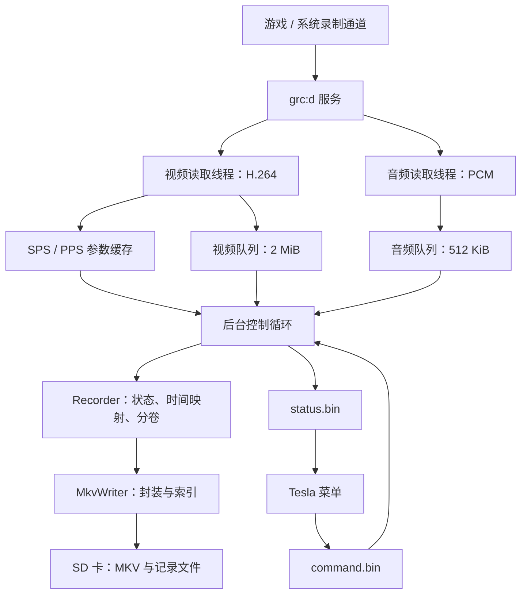

# Lite Recorder 0.2.1 技术实现文档

版本：0.2.1 Beta  
日期：2026-10-20  
适用对象：希望理解实现原理、维护源码或继续开发的读者。

本文依据本项目当前源码、构建配置及已有测试记录编写。“已经实现”“电脑测试通过”和“实机验证通过”分别说明，不将三者混为一谈。

## 1. 实现目标与主要思路

目标是在 Switch Lite 上完成带声音的长时间录制，直接保存到 SD 卡，并通过 Tesla 菜单控制开始、暂停、继续和停止。视频目标是 1280×720、接近 30 帧/秒；录制时长与文件大小只显示在菜单中。

核心方法是：**从系统录制服务读取已经编码的 H.264 视频和 PCM 音频，在本机重新组织时间戳，写成 MKV 文件。**

本项目没有在主机上运行截图循环、JPEG 编码或 FFmpeg，也没有自行实现 Tegra 硬件编码驱动。主要工作是取流、缓冲、控制状态、处理恢复边界，以及封装文件。

这样把开销集中在数据搬运和 SD 卡写入上，避免重新解码和编码每一帧。不过，实际性能仍受系统出流、其他后台模块、SD 卡延迟和游戏行为影响。

### 1.1 为什么可以超过原生的 30 秒录像

原生截取短录像的操作，与持续读取系统录制流并保存为自己的文件，是不同的调用路径。本项目不反复触发原生“保存过去 30 秒”操作，而是持续读取录制服务提供的数据。

因此，应用侧没有“每 30 秒必须结束”的文件逻辑。旧验证程序中的 120 秒截止也已经移除。系统仍必须持续提供可用数据；仅仅删除计时上限，无法解决视频源中断或缓冲溢出。

### 1.2 禁止录制的游戏如何处理

需要区分两个层次：

| 层次 | 职责 |
| --- | --- |
| 系统录制兼容层 | 让游戏能够向系统录制通道提供数据 |
| Lite Recorder | 读取通道、处理暂停和恢复、保存录像 |

当前环境另外安装了与固件匹配的 `dvr-patches` 兼容补丁。本插件不包含这项补丁，也不修改游戏程序来生成画面。补丁的适用范围和版本兼容性由上游项目决定；上游定位也是扩展多数游戏的录制支持，并非保证所有游戏都可录制。[上游项目说明](https://github.com/exelix11/dvr-patches)

## 2. 总体架构



菜单负责交互，后台负责持续工作。关闭菜单不会关闭后台，也不会因为界面消失而停止写文件。

### 2.1 源码模块

下表中的路径均相对于 0.2.1 源码包根目录。

| 文件 | 主要职责 |
| --- | --- |
| `src/probe.cpp` | 服务初始化、取流线程、队列调度、命令处理、状态与日志 |
| `src/packet_queue.hpp` | 固定容量的字节环形队列 |
| `src/avc.hpp` | Annex B 前缀处理、SPS 解析、SPS/PPS 保存与比较 |
| `src/recorder.hpp` | 开始、暂停、继续、恢复拼接、分卷和会话统计 |
| `src/mkv.hpp` | EBML、Matroska 轨道、媒体块、索引和文件收尾 |
| `src/protocol.hpp` | 菜单与后台的命令、状态格式及文件读写 |
| `src/overlay.cpp` | Tesla 菜单、命令发送、状态展示、后台启动 |
| `src/overlay_storage.hpp` | 菜单使用文件系统前的 SD 挂载检查 |
| `tests/recorder-replay.cpp` | 用真实采集数据运行相同录像核心 |
| `tests/validate-mkv.mjs` | 用 FFmpeg/ffprobe 验证生成文件 |

`probe.cpp` 和 `ovl-lite-probe.ovl` 的名称沿用了早期验证版，当前已经承担正式录像功能。旧 `capture_timing.hpp` 仍供历史测试和停止原因定义使用，其 120 秒验证逻辑不控制新版录制时长。

## 3. 从系统取得音视频

### 3.1 使用的接口

后台通过服务管理器取得 `grc:d` 会话。接口定义来自构建时使用的 libnx 源码：

| 调用 | 本项目使用方式 |
| --- | --- |
| IPC 命令 1，Begin | 在需要初始化时尝试一次 |
| IPC 命令 2，Transfer | 持续获取指定流的数据 |
| 流编号 0 | H.264 视频 NAL 数据 |
| 流编号 1 | 48 kHz、双声道、16 位 PCM 音频 |

Transfer 返回帧数、实际数据长度和起始时间戳。代码为每个媒体包补充本地接收时间、录制代号和参数版本等元数据。

libnx 明确说明：没有可用数据时 Transfer 会阻塞；Begin 不能重复调用，否则可能触发系统模块断言。本项目因此自行建立两个独立服务会话，分别供视频和音频线程使用，并在收到特定未初始化返回值 `0x3E8D4` 后，才通过互斥锁保护的一次性逻辑尝试 Begin。菜单的“开始录制”不会反复调用 Begin。接口依据见 libnx 的 `nx/include/switch/services/grc.h` 与 `nx/source/services/grc.c`。

### 3.2 为什么使用两个读取线程

如果把视频、音频和菜单控制串在一个循环里，一次等待视频就可能阻塞音频读取和“停止”命令。

当前结构有三个主要执行单元：

1. 视频线程：读取视频，观察参数集，将有效录制代号下的数据放入队列。
2. 音频线程：读取音频，放入独立队列。
3. 主控制循环：处理命令、取出排队数据、调用录像核心、发布状态。

暂停或停止时不等待阻塞中的读取线程退出。后台保留读取线程，通过数据代号控制哪些包允许进入当前录像。

### 3.3 三种时间不能混用

| 时间 | 用途 |
| --- | --- |
| 媒体源时间戳 | 决定帧和声音在录像中的位置 |
| 本机单调时钟 | 心跳、命令序号、取流停顿和写入耗时 |
| 系统日期时间 | 构造容易区分的会话目录名称 |

画面来自何时，由媒体时间戳决定；一次 SD 写入耗时多久，由单调时钟测量。修改系统时间不应直接改变录像内部时间线。

## 4. 缓冲与 SD 卡写入

### 4.1 字节环形队列

SD 卡写入可能短暂变慢，而视频包的大小变化很大。用少量“每格都按最大视频包预留”的槽位，会浪费内存，并容易在突发写入延迟期间耗尽可用槽位。

当前队列按实际数据长度使用空间：

| 项目 | 配置 |
| --- | ---: |
| 视频有效载荷容量 | 2 MiB |
| 音频有效载荷容量 | 512 KiB |
| 每种队列描述符上限 | 256 个 |
| 单次视频接收缓冲 | 512 KiB |
| 单次音频接收缓冲 | 4096 字节 |
| 写入器 stdio 缓冲 | 64 KiB |

数据在环形缓冲尾部可以跨界存放。读取端获得至多两块连续内存视图；消费完成之前，这些字节不能被生产者覆盖。外层互斥锁保护入队、查看队头和出队。

音频数据率为：

```text
48,000 个采样帧/秒 × 2 声道 × 2 字节 = 192,000 字节/秒
```

因此 512 KiB 音频字节容量理论上约能容纳 2.73 秒数据；实际还受包数量和包尺寸限制。视频缓存能覆盖多久取决于实际码率，不能换算成固定秒数。

### 4.2 调度与失败处理

主循环在两个队列都有数据时，先处理队头源时间戳较小的包；只有一个队列有数据时，处理已有数据。这不是对所有未来包进行全局排序。

每轮常规处理最多 64 个包，然后继续控制循环。循环末尾休眠约 10 毫秒；约每秒刷新文件缓冲、检查剩余空间、记录健康状态并发布状态文件。实际周期可能受阻塞写入影响。

队列满时报告故障，不覆盖尚未消费的数据来掩盖问题。H.264 画面之间存在依赖，随意丢掉一个普通帧，可能影响后续解码。

暂停和正常停止会先禁止新代号数据进入，再尽量消费已经接受的数据。异常停止则优先收尾已有文件，不能保证队列内尚未写出的数据都被保留。

## 5. 获取并校验视频参数

H.264 视频除了画面数据，还需要 SPS、PPS 参数集。它们描述解码所需的信息，不能只靠文件扩展名或填写“720p”代替。

视频线程即使处于待机或暂停状态，也会观察参数集。参数缓存在内存中，不跨重启复用其他会话的参数。

`AvcConfig::parse()` 的主要工作包括：

1. 识别三字节或四字节 Annex B 起始码。
2. 去除解析时需要处理的防竞争字节，按位读取 SPS。
3. 解析 profile、色度相关字段、位深、画面结构和裁剪信息。
4. 从实际参数计算尺寸，当前只接受 1280×720、逐行、8 位 AVC。
5. 保存原始 SPS/PPS，并通过逐字节比较判断参数是否变化。

这是针对当前输入的有限解析器，不是完整通用 H.264 解码器。PPS 被检查类型、长度并保存，没有实现所有语法和跨参数一致性的验证。

只含参数而不含图像切片的包不会被当成视频帧。参数版本随内容变化递增；若排队的视频包使用旧参数版本，而后台已经切换到新参数，控制层会跳过该包，避免用新参数描述旧数据。

**先加载后台再启动游戏**的要求来自这里：系统可能只在游戏开始时发送必要参数。后台启动太晚，虽然收到后续画面包，仍可能缺少创建可播放文件所需的信息。遇到这种情况会显示等待参数，而不是填入猜测的 SPS/PPS。

## 6. 在本机封装 MKV

### 6.1 封装与重新编码的区别

视频已经是 H.264，音频已经是 PCM。写入器主要添加轨道信息、时间戳、数据边界和索引。

选择 MKV 的工程理由是：可以在同一容器内保存现有 H.264 与 PCM，逐包写入，并在结束时补充时长及跳转索引，无需为了输出文件而增加主机端音频编码器。

PCM 的代价是体积较大：仅音频每小时约占 659 MiB，视频和容器开销另计。当前实现接受这个取舍，优先降低编码复杂度。

### 6.2 文件组织

```text
EBML Header
Segment（写入期间使用未知总长度）
  预留 SeekHead 空间
  Info：时间刻度、写入器名称、Duration
  Tracks：视频轨、音频轨
  Cluster + SimpleBlock
  Cluster + SimpleBlock
  …
  Cues：关键帧跳转索引
```

`SeekHead` 用于定位容器内的重要元素，`Cues` 提供按时间查找媒体位置的信息。这些结构的定义来自 [Matroska 官方元素规范](https://www.matroska.org/technical/elements.html)。

本项目的具体实现使用固定容量 EBML 缓冲，每个媒体包写入一个 Cluster 和 SimpleBlock。这样无需在内存里积攒很长的媒体段，但容器开销会比合并多个块的写法稍多。

轨道使用：

| 项目 | 当前值 |
| --- | --- |
| 视频 CodecID | `V_MPEG4/ISO/AVC` |
| 音频 CodecID | `A_PCM/INT/LIT` |
| 音频参数 | 48 kHz、2 声道、16 位 |
| TimestampScale | 100,000 纳秒，即 0.1 毫秒 |
| 视频 DefaultDuration | 33,333,333 纳秒 |

DefaultDuration 是名义帧时长，**不会把输入自动补成恒定 30 帧**。实际帧的位置仍按源时间戳计算。

### 6.3 视频数据转换

输入 NAL 使用 Annex B 起始码：

```text
00 00 00 01 | NAL 内容
```

写入 AVC 轨道时，变成：

```text
4 字节大端长度 | 原 NAL 内容
```

SPS/PPS 还会组成 AVCDecoderConfigurationRecord，写入轨道的 CodecPrivate。视频内容没有经过解码和重新编码。

当前按 GRC 提供的视频包进行封装，并依赖已验证输入的帧组织方式；没有额外实现任意 H.264 字节流的访问单元重组或 B 帧重排序。现有验证样本未发现 B 帧，不能据此声称支持任意 H.264 输入。

### 6.4 索引与收尾

写入器最多保留 1024 条关键帧索引，记录间隔至少约 2 秒，控制内存使用。接近 30 分钟的分卷策略也避免单文件索引无限增长。

停止或自动分卷时依次执行：

1. 追加 Cues 索引。
2. 回填 Duration。
3. 回填预留的 SeekHead。
4. 刷新并关闭文件。
5. 成功后将 `.mkv.part` 改名为 `.mkv`。
6. 更新分卷清单和播放列表。

回填文件头时，文件指针会向前移动。因此写入器分别保存当前位置和已写入最大范围，文件大小统计使用后者，避免菜单大小因回填而“缩小”。

## 7. 暂停后如何继续写入同一个文件

这是 0.2.1 的主要改动。

### 7.1 不能直接追加恢复后的普通帧

普通预测帧可能依赖暂停期间没有保存的画面。直接追加它们，可能出现花屏或解码错误。

因此暂停后，文件保持打开，但录像核心进入 `waitingKey` 状态。继续时先跳过无法独立开始解码的画面，等到 IDR 关键帧后再写入。等待期间的音频也不提前追加。

### 7.2 用两个时间锚点拼接

录像核心保存两个值：

- `base`：本次连续录制部分的第一个关键帧源时间戳。
- `outputBase`：这一部分应当接到当前文件的什么时间。

同一连续录制部分的音视频使用相同映射：

```text
文件时间戳 = outputBase +（源时间戳 − base）
```

首次创建文件时：

```text
base = 第一个有效关键帧的源时间
outputBase = 0
```

暂停后恢复时：

```text
base = 恢复后第一个有效关键帧的源时间
outputBase = 当前文件已有音视频的最晚结束时间
```

例如，已保存内容结束于 60.02 秒，暂停后收到的第一个关键帧源时间是 82.00 秒：

| 数据 | 源时间 | 写入文件的时间 |
| --- | ---: | ---: |
| 恢复关键帧 | 82.000 秒 | 60.020 秒 |
| 后续音频 | 82.012 秒 | 60.032 秒 |
| 后续视频 | 82.033 秒 | 60.053 秒 |

暂停产生的空窗被移除，恢复后音视频仍保持相同的相对时间关系。

接续点使用音视频共同的最晚结束时间，避免新视频或新音频覆盖上一部分尚未结束的音频。容器还会按 0.1 毫秒刻度舍入。边界可能存在少量画面等待或声音裁剪，不能称为逐帧、逐采样无损拼接。

### 7.3 音频边界

音频每个采样帧包含左右声道，共 4 字节。若音频包从 `base` 之前开始，代码按完整采样帧裁掉开头：

```text
裁剪采样帧数 = 向上取整（领先时间 × 48,000 / 1,000,000）
```

完全早于起点的包会被跳过。明显超前于最近视频的数据也会被拒绝，避免视频停流后音频独自延伸很长时间。当前允许的超前窗口为 2 秒，这属于启发式边界处理，不是对每个游戏的完全同步保证。

### 7.4 暂停为什么还要有“录制代号”

用户点击暂停时，某个读取线程可能仍在阻塞调用里，稍后才返回数据。

后台使用 `generation` 标记一次有效数据接收阶段：

1. 开始或继续时，分配新的非零代号。
2. 读取线程在进入阻塞调用前记下代号。
3. 调用返回后，只有代号仍有效且未变化的数据才允许排队。
4. 暂停时将生产端代号置零，并消费之前已接受的队列数据。
5. 继续时使用新代号，迟到的旧调用结果不会混入新阶段。

这也意味着边界附近少量包可能被舍弃；恢复必须等待关键帧，正是为了让这种舍弃后的画面重新具备独立解码起点。

## 8. 返回 HOME 与自动分卷

### 8.1 视频源中断恢复

手动暂停由命令触发；HOME 中断则通过数据判断，不依赖“用户按了 HOME”的系统事件。

实现包含两个判断：

| 判断依据 | 作用 |
| --- | --- |
| 约 2 秒没有收到视频或声音 | 菜单提示等待取流恢复 |
| 相邻有效视频源时间戳相差至少 2 秒 | 恢复时进入关键帧等待和时间重映射 |

0.2.1 不因为这种长中断关闭当前文件。后续关键帧到来后，按照上一节的方法继续写入同一文件。

这项处理针对可识别的长空窗。短于阈值的间隔会保留在时间线上；如果系统时间戳的变化无法反映实际等待，代码也不能仅凭“回过 HOME”就精确剪掉所有等待时间。菜单使用的接收时间与文件使用的源时间，不能互相替代。

### 8.2 保留的自动分卷

自动分卷条件保持为：

```text
当前文件大小达到约 1 GiB
或当前文件媒体时长达到 30 分钟
```

条件成立后，在后续关键帧处关闭旧文件，并从该关键帧开始新文件。因此实际文件可能稍微超过阈值，分卷边界不是任意字节或任意普通帧。

另外保留两项保护：

- 参数集发生变化时，关闭旧文件，等待适合新参数的关键帧再开文件。
- 达到阈值却迟迟不能正常分卷时，单文件超过 1.5 GiB 的检查会触发停止保护；它是检查阈值，不是精确截断后的文件尺寸。

1 GiB／30 分钟是本项目主动选择的分卷策略，不是 MKV 格式规定的上限。它为文件系统和写入实现保留余量，也限制单次异常可能影响的当前文件范围。

若继续录制时旧文件已经达到阈值，恢复关键帧仍会触发正常分卷；不能将这种情况误判成“暂停又强制分段了”。

## 9. 菜单控制与统计

菜单基于 libtesla，后台模块编号为 `00FF4C5250524231`。菜单的“加载后台”通过程序启动服务启动后台；安装包不设置开机自启标记。

控制与状态采用两个小文件：

```text
sdmc:/config/lite-recorder/command.bin
sdmc:/config/lite-recorder/status.bin
```

| 协议项目 | 当前实现 |
| --- | --- |
| 协议版本 | 4 |
| 命令长度 | 32 字节 |
| 状态长度 | 320 字节 |
| 命令 | Start、Stop、Pause、Resume |
| 启动身份 `boot` | 避免旧后台生命周期的命令再次执行 |
| 递增命令编号 `id` | 拒绝重复和旧命令 |
| 心跳 | 后台约每秒更新，菜单拒绝超过约 4 秒的陈旧状态 |

文件先写到临时路径，再重命名替换。若底层文件系统不支持覆盖式重命名，会先删除旧目标再改名，因此不能宣称所有情况都具有严格原子替换。读取端要求长度完整；短暂缺失或不完整文件不会当成有效命令。

菜单发送命令后等待后台确认，再接受下一条操作。命令编号只有在写入成功后才更新，避免一次写入失败导致后续一直等待不存在的确认。

统计来自实际写入结果：

- 累计时长：所有已结束文件时长，加当前文件的媒体结束时间。
- 总大小：已结束文件字节数，加当前文件已经写入的范围。
- 暂停：不再增加媒体数据，统计冻结。
- 文件数：已经完成的文件数与本次创建的总文件数。

时长不是点击开始后经过的墙上时间，大小也不是按照估算码率相乘得到的数值。停止时补写索引，最终大小可以略有增加。

## 10. 文件保存与故障处理

每次“开始录制”建立新会话目录：

```text
recordings/lite-recorder/<时间标记>-<单调时钟标记>-<序号>/
  000001.mkv
  000002.mkv.part
  segments.csv
  playlist.m3u
  summary.json
  health.csv
```

| 文件 | 含义 |
| --- | --- |
| `.mkv` | 已完成收尾和改名的录像 |
| `.mkv.part` | 当前正在写入，或没有正常完成的文件 |
| `segments.csv` | 完成文件的时长、大小和结束原因 |
| `playlist.m3u` | 已完成文件的播放顺序 |
| `summary.json` | 最终状态、故障、总时长、总大小和包数 |
| `health.csv` | 取流间隔、队列峰值、溢出和写入耗时 |

`health.csv` 还保留视频、音频队列各自的峰值和溢出次数。队列峰值属于后台进程生命周期；最大写入、刷新耗时在新会话开始时重置。

空间不足 256 MiB、队列满、服务调用失败、时间戳异常、格式不支持或文件操作失败时，会停止并报告错误。能够正常收尾的内容会尽量保存；文件关闭或改名失败时保留 `.part`。

文件改名成功以后，若清单写入失败，也可能出现“MKV 存在，但整次会话报告文件错误”的情况。媒体文件完成与所有附属记录完成，是两个不同步骤。

每秒 `fflush` 的作用是刷新应用缓冲，不等于突然断电时拥有事务级保存保证。**0.2.1 暂停不关闭文件，必须再点击“停止并保存”才能完成索引与改名。**

## 11. 调试过程中解决了什么

| 现象 | 采取的处理 | 能得出的结论 |
| --- | --- | --- |
| 从菜单启动时出现全屏异常 | 根据回溯定位文件操作初始化，补齐 SD 挂载顺序与错误处理 | 这是菜单初始化问题，不能与后来的菜单内取流错误混为一谈 |
| 只保存很短的一段，看起来像 30 秒限制 | 增加原始包、源时间戳、数据年龄和停止原因记录 | 后续长录制证明并非固定 30 秒上限；不同停录仍需按各自日志分析 |
| HOME 或菜单操作后提示取流中断 | 将等待源恢复与真正故障区分，取消旧验证超时对正式录制的限制 | 暂时无数据不必立刻结束会话 |
| 数据队列满 | 使用按字节分配的环形缓冲，扩大突发容纳能力并记录写入耗时 | 已测场景未再溢出，不代表任何 SD 卡和负载下都不会溢出 |
| 有视频包但无法正确播放 | 获取实际 SPS/PPS，按关键帧起录，拒绝猜测参数 | 收到字节不等于已经取得可解码录像 |
| 暂停和 HOME 操作产生很多文件 | 0.2.1 保持文件打开，恢复后重映射时间戳 | 日常暂停不再增加文件数，正常阈值分卷保留 |

## 12. 验证方法与当前证据

### 12.1 为什么把录像核心抽出来测试

`Recorder` 与 `MkvWriter` 不依赖菜单或取流线程。测试程序读取之前实机采集的 H.264、PCM 和包时间戳，调用与 Switch 后台相同的 C++ 核心，再用独立工具检查结果。

这可以验证封装、时间映射、关键帧边界和失败处理。它不能模拟 Switch 的线程调度、所有服务行为或 SD 卡真实阻塞，因此还需要实机测试。

FFmpeg/ffprobe 仅用于开发电脑上的验证，不参与 Switch 录制，也不随安装包部署到主机。

### 12.2 0.2.1 回放结果

| 场景 | 文件数 | 视频帧数 | 累计媒体时长 |
| --- | ---: | ---: | ---: |
| 两次原始 HOME 长中断 | 1 | 2177 | 74.928 秒 |
| 额外暂停十秒 | 1 | 1870 | 64.694 秒 |
| 快速暂停约 0.1 秒 | 1 | 2170 | 74.695 秒 |
| 暂停后停止 | 1 | 548 | 20.015 秒 |
| 降低大小阈值为 8 MiB | 6 | 2177 | 74.978 秒 |
| 降低时长阈值为 10 秒 | 8 | 2177 | 75.002 秒 |
| 重复推进时间戳，验证多次恢复 | 1 | 6531 | 224.808 秒 |
| 缺少参数 | 0 | 0 | 0 秒 |
| 注入源时间戳回退 | 1 | 2177 | 74.928 秒，拒绝异常包 |

共 20 个 MKV、19,827 帧通过完整解码和中途跳转检查。还验证了轨道时间戳不倒退、恢复关键帧出现在连续接续点、字节数与时长一致、暂停统计冻结，以及改名失败保留临时文件。

测试用降低阈值只作用于测试实例，安装版仍使用 1 GiB／30 分钟。

### 12.3 已有实机结果

0.2.0 在当前主机与《魔法使之夜》环境中，成功保存：

- 5 个 MKV；
- 10 分 46.947 秒；
- 405,794,965 字节，约 387 MiB；
- 19,312 帧，按总帧数除以媒体时长计算约 29.85 帧/秒；
- 两次主动暂停，以及两次与 HOME 操作相符的视频源中断恢复。

文件全部通过解码与跳转检查，队列溢出为零。这个结果验证了原有取流和保存路径。**截至本文编写时，0.2.1 同文件续录仍未获得新的实机结果。**

### 12.4 已知边界

当前还不能保证恒定 30 帧、所有游戏可录制、任意编码参数切换、任意时间戳重置或跨游戏连续录制。真实达到 1 GiB／30 分钟的分卷，以及数小时持续录制，仍需实机覆盖。

读取器不保存一套完整待机录像，因此“开始录制”也不等于导出之前的历史画面。等待 IDR 会舍弃少量恢复画面；缺少参数时必须先解决参数获取问题。

## 13. 构建、部署与维护入口

开发环境为 Windows，目标为 Switch AArch64。使用 devkitA64、libnx 4.12.0 和 switch-tools；具体依赖版本与下载包哈希记录在源码包的 `dependencies.json` 中。

在解压后的源码根目录运行：

```powershell
./build.ps1 -DevkitPro C:/devkitPro
node tools/check-package.mjs .
```

`C:/devkitPro` 是示例工具链位置，需要替换为实际路径。构建流程编译后台 ELF，生成 NSO、NPDM 并封装为 `exefs.nsp`；另行编译菜单，生成带 NACP 信息的 NRO 浮层。

安装位置：

```text
atmosphere/contents/00FF4C5250524231/exefs.nsp
atmosphere/contents/00FF4C5250524231/toolbox.json
switch/.overlays/ovl-lite-probe.ovl
```

后台服务列表包含 `fsp-srv`、`set:sys`、`time:u`、`grc:d`、`pm:dmnt`。菜单另行使用程序启动服务。当前 NPDM 采用较宽的文件系统权限配置，不能称为已经完成最小权限审计。

主要内存与线程配置使用固定容量：后台堆 384 KiB，主线程栈 128 KiB，两个读取线程栈各 32 KiB；媒体环形队列等大型缓冲位于静态存储区，不从这 384 KiB 堆里临时申请。后台主线程与读取线程配置在核心 3、优先级 44，实际仍由系统调度。

维护时可按问题类型定位：

| 问题 | 优先检查 |
| --- | --- |
| 菜单无响应或命令未确认 | `overlay.cpp`、`protocol.hpp`、心跳与命令文件 |
| 没有音视频数据 | `probe.cpp`、兼容补丁、参数缓存和服务返回值 |
| 恢复后时间跳跃或音画边界异常 | `recorder.hpp` 的 `base`／`outputBase` |
| 文件无法播放或跳转 | `mkv.hpp`、SPS/PPS、关键帧和收尾结果 |
| 长录制丢失或停止 | 空间检查、队列峰值、写入延迟、分卷条件 |

## 14. 代码来源与许可证

项目代码按 GPL-3.0-or-later 提供。录像控制、AVC 参数解析和 MKV 写入实现保存在本项目源码中，依赖及参考关系如下：

- libnx：提供 Switch 系统服务和运行时接口，接口定义可查阅 [libnx 4.12.0 源码](https://github.com/switchbrew/libnx/tree/v4.12.0)。
- libtesla：提供浮层 UI 框架，随源码包附带来源、许可证和本地修改说明。
- free-record-switch：适配了其后台模块能力配置元数据，没有采用其 JPEG／AVI 截图录制实现。
- SysDVR：参考了取流行为和限制，没有复制其固定视频参数数组或将其程序打包进本插件。
- dvr-patches：独立安装的上游兼容补丁，不是本项目新增的录像核心。
- Matroska 规范：用于容器元素和轨道格式的实现依据。

完整许可证与依赖说明以源码包中的 `LICENSE`、`THIRD-PARTY.md` 和 `licenses/` 为准。

## 配套资料

- [0.2.1 源码包](C:/Users/jasttenet/Documents/Codex/2026-10-20/w/outputs/LiteRecorder-0.2.1-beta-source.zip)
- [0.2.1 使用与复测说明](C:/Users/jasttenet/Documents/Codex/2026-10-20/w/outputs/Lite录屏0.2.1-使用与复测说明.md)
- [0.2.1 验证记录](C:/Users/jasttenet/Documents/Codex/2026-10-20/w/outputs/Lite录屏0.2.1-验证记录.md)
- [0.2.0 实机录制验证](C:/Users/jasttenet/Documents/Codex/2026-10-20/w/outputs/Lite录屏0.2.0-实机录制验证.md)
